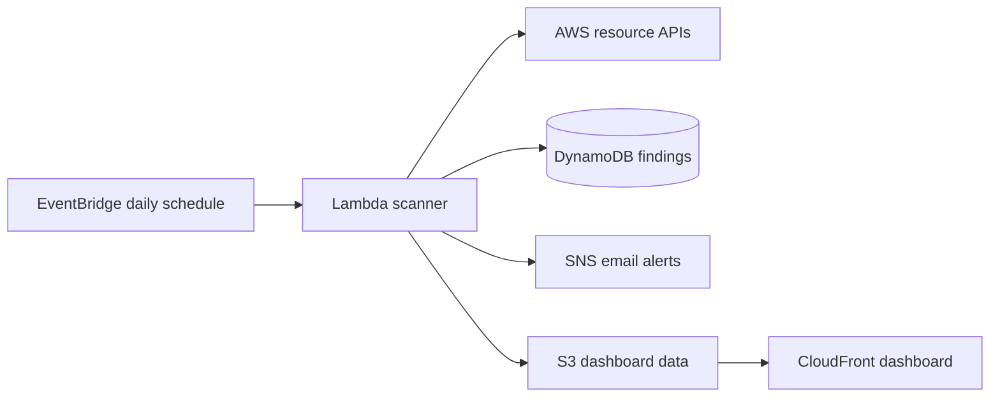

# Automated Security Compliance Scanner for AWS

This project is a lightweight, serverless AWS security scanner. It runs on a schedule, checks common cloud misconfigurations, stores findings, sends alerts for new high-risk issues, and publishes a static security dashboard.

## What it checks

| Service | Rule | Severity |
|---|---|---|
| EC2 | Security groups exposing SSH (22) to the internet | High |
| EC2 | Security groups exposing RDP (3389) to the internet | High |
| EBS | Unencrypted volumes | High |
| RDS | Public database instances | High |
| RDS | Unencrypted database storage | High |
| S3 | Public bucket policies without restrictive public-access blocking | Critical |

The scanner is read-only. It reports risks and recommendations but does not change resources.

## Architecture



## Repository structure

- `src/` - scanner, Lambda handler, and DynamoDB persistence
- `dashboard/` - static HTML/CSS/JavaScript dashboard
- `terraform/` - complete AWS infrastructure definition
- `tests/` - unit tests for rules, storage, and alert logic
- `.github/workflows/ci.yml` - automated tests and Terraform validation
- `dashboard/dashboard-data.example.json` - synthetic starter data for the dashboard
- `docs/` - deployment and demonstration instructions

Local scan output and reports are excluded from Git because they can contain AWS account and resource details.

## Run locally

Python 3.11+ and AWS credentials are required.

```bash
python3 -m venv .venv
source .venv/bin/activate
python -m pip install -r requirements.txt
export AWS_PROFILE=scanner
python src/security_scanner_v2.py --region eu-north-1 --output findings-v2.json
python src/store_findings.py findings-v2.json --region eu-north-1
```

To open the local dashboard against the authenticated AWS profile, run `Open Dashboard.command` or start it from Terminal with `export AWS_PROFILE=scanner` followed by `.venv/bin/python local_app.py`. The dashboard's **Run scan** action reads AWS resources and updates local dashboard data; it does not store findings in AWS or send alerts.

Run the unit tests without AWS credentials:

```bash
python3 -m unittest discover -s tests -v
```

## Deploy with Terraform

```bash
cd terraform
terraform init
terraform validate
terraform apply
```

After applying, confirm the SNS email subscription and open the `dashboard_url` Terraform output. See `docs/DEPLOYMENT.md` for the full procedure.

## Verified result

The supplied evidence records a completed scan in `eu-north-1`: one security group checked, zero errors, and zero findings. A clean result means the implemented rules found no issue in the resources examined; it is not a guarantee that the whole account is secure.

## Safety and cost

- The scanner uses read-only resource inspection permissions.
- The dashboard's CLI scenarios intentionally create exposed or unencrypted resources. Run them only in a dedicated disposable test account, never in production, and clean them up when finished.
- The dashboard bucket remains private and is accessed through CloudFront Origin Access Control.
- DynamoDB uses on-demand billing, Lambda uses a short timeout, and logs expire after 14 days.
- Destroy demonstration resources when finished: `terraform destroy`.

## Scope

This is an educational baseline scanner. It does not replace AWS Security Hub, AWS Config, GuardDuty, Prowler, ScoutSuite, or a professional security review.
